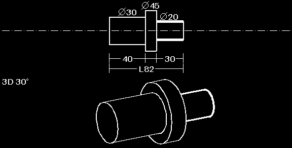

# EvenCAD — voice to engineering drawing on Even Realities G2

> Say it. See it. Sign it.

**Status (Nov 23): the full flow works in the simulator.** Not tested yet: real G2 glasses, the real Anthropic API, a real Google Drive account. See [Known limits](#known-limits).

Built for the "Heads Up: Even Realities Hackathon" (Nov 23–29, 2026).
Track: **04 · AI Assistants & Work**.

Idea and spec were prepared before Nov 23. All code was written during the hackathon.

## Problem and user

A worker holds a part and a caliper. Their hands are busy. They say the shaft
dimensions out loud. The G2 glasses show a side view that grows as they speak.
They confirm with a tap or the R1 ring. At the end they get STEP, DXF and PDF files.
No computer and no CAD program is needed.

The output is always a **DRAFT**. A human must approve it. The system never approves by itself.

## How it works

```
G2 glasses app (TypeScript, Even Hub SDK)
   │  audio / input events / spec state
   ▼
Backend (Python, FastAPI)
   speech → text → Claude → typed operations → plain code applies, validates, draws, exports
```

The AI never writes geometry. It only returns small typed operations.
Full design: [EVENCAD_SPEC.md](EVENCAD_SPEC.md). SDK facts: [docs/sdk-notes.md](docs/sdk-notes.md).

## What works today

The end-to-end slice, by voice or by typed text:

speech → Whisper (on our server) → text → Claude (interpreter) → typed operations → ShaftSpec → validation → drawing on the glasses (simulator) → STEP, DXF, PDF.

- Operations, undo, validation (errors and warnings) and read-back, all in plain code with tests.
- One vector model of the side view. It feeds the glasses image, the DXF and the PDF.
- Glasses page: status line, drawing (two 288 × 144 image tiles), read-back and warnings.
- Tap on the glasses starts listening. It stops after 1.5 s of silence, on a second tap, or after 20 s.
- Guided measuring: the display always asks for the next number, for example `Next: segment 2 diameter?`.
  A bare number answers it ("twenty five", then "sixty"). The server reads the number itself. No model call, so it is fast.
  After a diameter the app listens for the length at once, with no extra tap. Full sentences still work at any time.
  Undo drops a half-entered segment first.

  
- The segment that the last sentence changed is drawn with thicker lines, in the 2D view and in the 3D view.
  One look shows what the last sentence did. Undo moves the mark back.

  
- Tap also accepts a warning. Double tap opens the system exit dialog.
- Swipe turns the drawing: 2D side view with dimensions, then a 3D line view at 30°, 60°, 90° (end view), 120°, 150°.
  The glasses show images only, so the 3D view turns in steps, one image per step.
- Speech to text runs on the backend with faster-whisper (`base.en`, about 1 s per sentence on a laptop CPU).
- `finish` makes `data/out/<session id>/shaft.step`, `shaft.dxf`, `shaft.pdf`.
- Phone page `/s/<session id>`: the 2D side view, downloads, and the human "Approve for review" step.

- `finish` also copies the three files to a Google Drive folder (when Drive is set up). Approval replaces the DXF and PDF there.

Not done yet: real G2 test, one-command start.

The interpreter has two adapters with the same prompt and the same JSON answer:

- `INTERPRETER=api` (default): the Anthropic API. Needs `ANTHROPIC_API_KEY` in `.env`. Model: `CLAUDE_MODEL` (default `claude-haiku-5-5`).
- `INTERPRETER=cli`: the Claude Code CLI, for development without an API key. Slow (5–8 s per sentence).

The API adapter is tested with a fake client only. It has not been run against the real API yet (no key on the dev machine).


## Quick start (one command)

Needs Node.js 22 LTS or newer, and Python 3.11+ (or Docker).

```bash
# Windows
powershell -ExecutionPolicy Bypass -File scripts\start.ps1

# macOS / Linux
./scripts/start.sh
```

The script creates `.env` from `.env.example`, installs everything, and starts the backend
(port 8000), the app dev server (port 5173) and the simulator. The first run takes a few minutes.
Then add your `ANTHROPIC_API_KEY` to `.env` and start it again.

In the simulator: **Click** = tap. Tap, speak into the PC microphone, wait. Or type a sentence in
the app page, for example `diameter thirty, forty long`. Say or type `finish` to get the files.

Options: `-NoSimulator` / `--no-simulator`, and `-Docker` / `--docker` to run the backend in a
container. Backend only: `docker compose up --build`.

Tested so far: `scriptsstart.ps1` on Windows 11. The bash script and the Docker build are written but not run yet.

## Setup step by step

Needs: Node.js 22 LTS (or newer), Python 3.11+.

### Backend

```bash
python -m venv .venv
.venv/Scripts/python -m pip install -r requirements-dev.txt     # Windows
# .venv/bin/python -m pip install -r requirements-dev.txt       # macOS / Linux
cp .env.example .env
.venv/Scripts/python -m uvicorn server.main:app --reload --port 8000
```

Open `http://localhost:8000/docs` for the API. Type a sentence in the app page (below), or call
`POST /session` and `POST /session/{id}/utterance` with `{"text": "diameter thirty, forty long"}`.

### Google Drive (optional)

The backend uploads with your own Google account. The glasses app never sees Google.
The app asks only for the `drive.file` scope: it can see only the files it creates.

1. In the Google Cloud Console: create a project, enable the **Google Drive API**, set up the OAuth consent screen (add yourself as a test user), and create an **OAuth client ID** of type **Desktop app**.
2. Download the client file to `data/google_client.json` (the `data/` folder is not in git).
3. Run `.venv/Scripts/python -m tools.drive_auth`. A browser opens. Sign in and allow access.
4. The tool creates the folder "EvenCAD drawings" and prints a `GOOGLE_DRIVE_FOLDER_ID=...` line. Put it into `.env`.
5. Restart the backend. Each finished session gets its own sub-folder with `shaft.step`, `shaft.dxf`, `shaft.pdf`.

If Drive fails, the drawing is still finished and the files stay downloadable from the phone page.

### Glasses app in the simulator

```bash
cd app
npm install
npm run dev          # terminal 1
npm run simulate     # terminal 2
```

The app talks to `http://localhost:8000`. Set `VITE_BACKEND_URL` in `app/.env.local` to change it.
Script a session without typing: `evenhub-simulator "http://localhost:5173/?say=diameter thirty, forty long|finish"`.

### Glasses app on real G2

Not tested yet. The planned steps, from the Even Hub docs:

1. The phone must reach the backend. Put the backend address into `app/.env.local` as
   `VITE_BACKEND_URL=...` and into the `whitelist` in `app/app.json` (full origin, for example
   `https://evencad.example.com`). Plain `http://` works only for a dev server on the same network.
2. `cd app && npm run dev`, then `npx evenhub qr --url http://<LAN-IP>:5173`.
3. In the Even Realities app (developer mode), open Even Hub and scan the QR code.
4. Package for upload: `npm run pack` makes an `.ehpk` file.

## Environment variables

See [.env.example](.env.example). Keys live only on the server, in `.env`. `.env` is never committed.

## Input mapping

Current mapping (simulator). It is checked again on real G2.

| Input | Action |
|---|---|
| Tap (temple or R1 ring) | start listening / stop listening / accept a warning |
| Double tap | system exit dialog (store rule) |
| Voice: "undo", "finish" | undo the last change / build the files |
| Swipe down / swipe up | next view / previous view (2D, then 3D at 30°, 60°, 90°, 120°, 150°) |
| Long press | not used yet |

## Tests

```bash
.venv/Scripts/python -m pytest          # unit tests, no network
.venv/Scripts/python -m pytest -m live  # asks the real model (INTERPRETER=cli or api)
.venv/Scripts/python -m tools.record_golden   # record fresh model answers into samples/golden.json
```

## Privacy and safety

- Audio is never stored. One sentence is held in memory, turned into text, and dropped. A test checks that no audio reaches the disk.
- The microphone is open only while the display says "Listening".
- Google Drive: scope `drive.file` only. The token stays on the server in `data/` (not in git).
- No secrets in the glasses app. All external calls go through our backend.
- Every PDF carries "DRAFT – requires engineering approval" until a human approves it.
- Tests and the demo use made-up parts only.

## What existed before Nov 23

Only the specification ([EVENCAD_SPEC.md](EVENCAD_SPEC.md)). No code.

## Open-source libraries and tools

| Name | Use | License |
|---|---|---|
| [evenhub-templates / minimal](https://github.com/even-realities/evenhub-templates) | starting point of `/app` | MIT |
| `@evenrealities/even_hub_sdk` | bridge to the glasses | MIT |
| `@evenrealities/evenhub-cli`, `@evenrealities/evenhub-simulator` | packaging, simulator | see npm |
| Vite, TypeScript | app build | MIT, Apache-2.0 |
| FastAPI, Uvicorn, Pydantic | backend | MIT, BSD-3-Clause, MIT |
| CadQuery (OpenCascade) | STEP export | Apache-2.0 |
| ezdxf | DXF with dimensions, DXF → PDF drawing | MIT |
| Matplotlib | PDF backend | PSF-style (BSD compatible) |
| Pillow | glasses image | MIT-CMU |
| faster-whisper (CTranslate2, Whisper `base.en` model) | speech to text on the server | MIT |
| `anthropic` (official SDK) | interpreter, default adapter | MIT |
| google-api-python-client, google-auth, google-auth-oauthlib | Google Drive upload | Apache-2.0 |
| pytest, httpx, pypdf | tests | MIT, BSD-3-Clause, BSD-3-Clause |
| Claude Code CLI | interpreter during development only | Anthropic terms |

## Path to launch in Even Hub

**Who needs it.** People who measure and make parts by hand: workshops, small machine shops,
field service, students. They have a part and a caliper, and no CAD seat at the bench.

**What is ready.** The app builds into an `.ehpk` package (`npm run pack`, checked with CLI 0.2.0).
It asks for two permissions only: `network` (one origin, our backend) and `g2-microphone`.

**What is needed to go live.**

- A hosted backend with a fixed HTTPS address (the whitelist is fixed inside the package).
- A store name without the word "Even" (store rule). The working name in `app.json` is "ShaftCAD Draft".
- Per-user Google Drive sign-in through a pairing page on the phone. Today the server uses one account.
- A short pairing code instead of the session id on the glasses.
- Usage limits per user, and a spend limit on the API key.
- Cost per drawing: a few short Claude calls with a small model, and speech-to-text on our own
  server. The Claude part is far below one cent per drawing at list prices. The server CPU is the main cost.
- Even Hub review: icon, privacy policy, beta test on real glasses with the phone locked.

**Safety model.**

- The output is a DRAFT. The mark is on every PDF and DXF until a person approves it on the phone page.
- The AI cannot approve. It has no operation for it, and a test checks that such an answer is refused.
- The AI never writes geometry. It returns small typed operations. Plain code validates and draws.
- If the AI is unsure, it asks. It does not guess a missing number.
- Audio is never stored. Secrets stay on the server. Tests and demos use made-up parts.

## Known limits

- **Not tested on real G2.** Image refresh speed, text size, the microphone level and the input
  mapping are checked only in the simulator.
- **Not run against the real Anthropic API or a real Google Drive.** Both are tested with stand-ins.
  The development runs used the Claude Code CLI adapter.
- **Speed.** The target is under 4 seconds from the end of speech to the new drawing. Speech-to-text
  takes about 1 second here. The Claude call is not measured with the API yet.
- **Speech-to-text** was checked with a computer voice only. Human voices and workshop noise are open.
- **One part family:** stepped shafts with chamfers. No threads, keyways, tolerances or fits.
- **Drawing polish.** Diameter dimensions on the sheet cross the centre line.
- **One Google account, no user accounts.** Anyone who knows a session id can open its phone page.
- English only.

More detail: [docs/open-questions.md](docs/open-questions.md).

## Feature requests

See [FEATURE_REQUESTS.md](FEATURE_REQUESTS.md).
